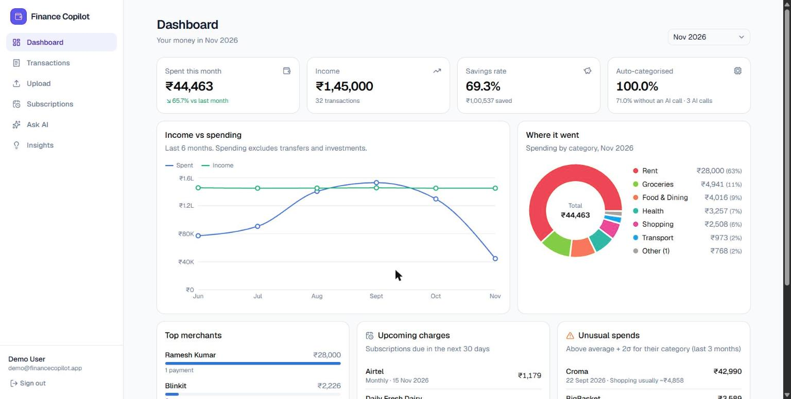
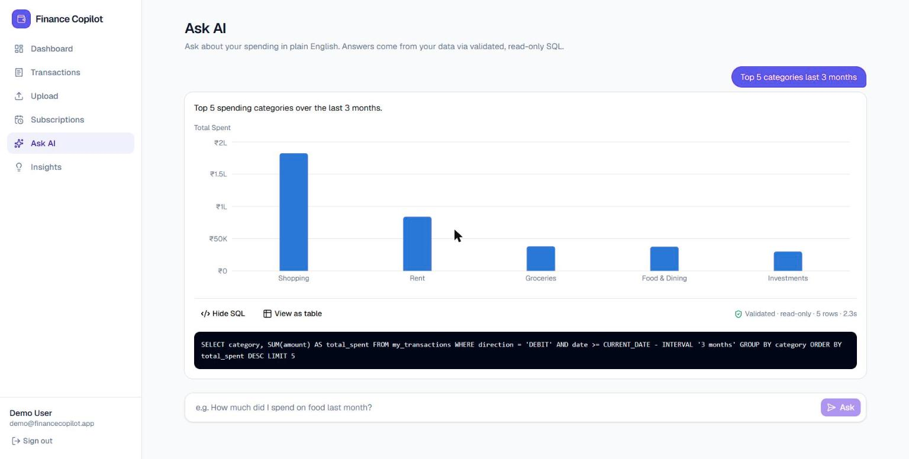
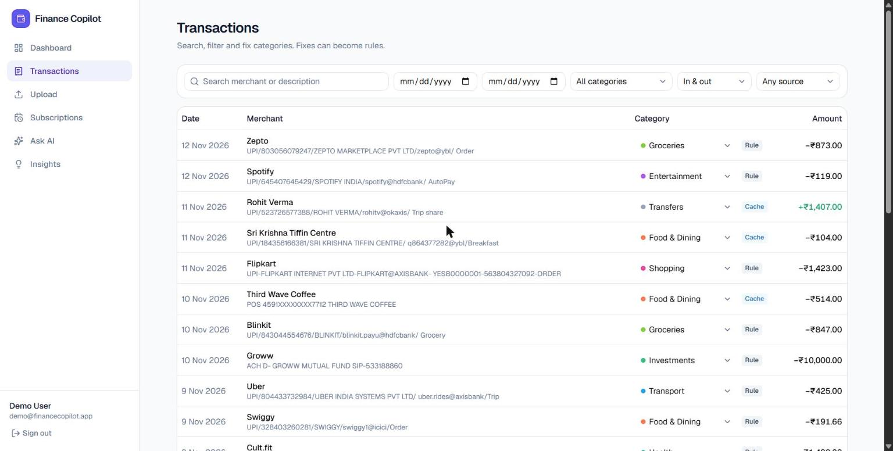
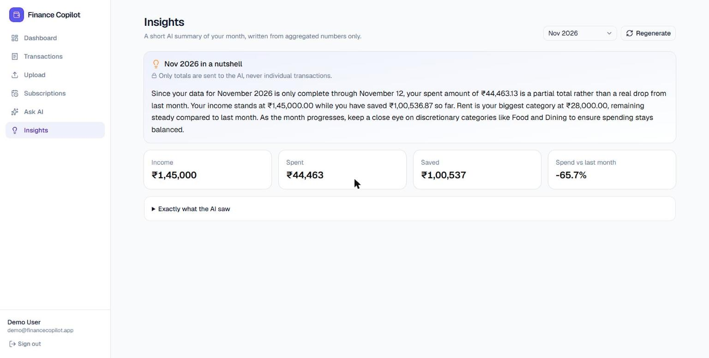
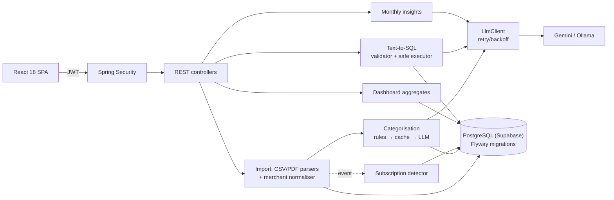

# Finance Copilot

**Upload an Indian bank statement and get your money explained in seconds.** Finance Copilot parses CSV and PDF statements, categorises every UPI/card/NEFT transaction (rules first, AI only for the unknowns), finds your subscriptions, and lets you ask questions like *"How much did I spend on Swiggy in October?"*. The AI writes the SQL, and the backend proves the SQL is safe before running it.


## Live demo

**App:** https://FRONTEND_URL &nbsp;·&nbsp; **API docs (Swagger):** https://BACKEND_URL/swagger-ui.html

Log in with **demo@financecopilot.app / Demo@123**, or click *Try the demo account*. The demo account already has 6 months of sample statements loaded, so try **Ask AI** and **Insights** straight away.

> The backend runs on a free tier that sleeps when idle, so the first request can take about 50 seconds. Everything is fast after that.

Frontend on Vercel · backend (Docker) on Render · PostgreSQL on Supabase.

---

## Highlights

| | |
|---|---|
| **Cost-aware AI** | A 4-stage categorisation pipeline answers most transactions with rules and a shared cache. On the 6-month sample, **69% of rows needed no AI on a cold start, and 100% once the cache was warm**. The 154 rows left over took **one** batched LLM call (12 distinct merchants), not 154. |
| **Safe text-to-SQL** | LLM output is treated as untrusted input. It is AST-validated with JSqlParser, scoped to the caller with a bound parameter, and executed in a **read-only** transaction with a **3 s timeout** and a 500-row cap. |
| **Indian-bank aware** | It handles UPI narrations (`UPI/628712345678/SWIGGY/swiggy@icici/...` → *Swiggy*), Indian digit grouping (`1,45,000.00`), `Dr/Cr` suffixes, preamble lines and different column layouts. |
| **Deterministic where it matters** | Subscription detection and anomaly flags are plain, unit-tested Java and SQL. No AI is involved. |
| **Tested end to end** | 90+ tests, including Testcontainers tests that prove **one user can never read or change another user's data**, even through Ask-AI. |

## Features

- **Auth**: register and login with BCrypt and stateless JWT. Every query is scoped to the authenticated user.
- **Statement upload**: CSV with automatic column detection (date / narration / debit / credit / amount / Dr-Cr / balance, any delimiter) and text-based PDFs (PDFBox). Duplicate rows are skipped by content hash, and identical re-uploads are rejected.
- **Categorisation pipeline**: user rules → built-in Indian merchant rules → shared merchant cache → batched LLM. Every transaction records *how* it was categorised (`RULE`, `CACHE`, `AI`, `USER`, `NONE`).
- **Fix-and-learn**: recategorise any transaction inline, and optionally turn the fix into a rule that also updates past and future transactions from that merchant.
- **Subscriptions**: weekly, monthly and yearly recurring charges with average amount, next expected date and yearly cost.
- **Dashboard**: monthly income vs spending, savings rate, spend by category, 6-month trend, top merchants, upcoming charges, unusual spends (> mean + 2σ for the category) and the "% categorised without AI" metric.
- **Ask AI**: chat-style questions, each answered with a bar, line or pie chart, a number or a table, plus a "Show SQL" toggle.
- **Insights**: a short monthly summary written by the AI from aggregated figures only. The page shows exactly what was sent.
- **API quality**: DTO records, Bean Validation, RFC 7807 `problem+json` errors, pagination and filters, OpenAPI / Swagger UI.

## Screenshots

> Captured from the running app with the generated sample data. More in [`docs/screenshots`](docs/screenshots).

| Dashboard | Ask AI |
|---|---|
|  |  |
| **Transactions** | **Insights** |
|  |  |

## Architecture



More diagrams (upload pipeline, Ask-AI sequence, ER model) are in [`docs/architecture.md`](docs/architecture.md).

**Backend layout** (`backend/src/main/java/app/financecopilot`): `controller`, `service`, `repository`, `domain`, `dto` (records), `config`, `security`, `exception`, `parsing`, `categorization`, `subscription`, `ai`, `ai/sql`.

## Design deep-dive (the interesting parts)

### 1. Categorisation pipeline: AI as the last resort

```
(a) user rules  →  (b) built-in merchant rules  →  (c) shared merchant cache  →  (d) LLM
     free              free (~90 Indian brands)        free after first sight         paid, batched
```

- Each `CategorizationStep` only receives what the earlier steps could not resolve (`CategorizationService`), so the expensive step sees the smallest possible input.
- **Normalisation makes caching work.** `MerchantNormalizer` strips the payment rail, reference numbers, IFSC codes, VPA handles and legal suffixes, so `UPI-ZOMATO LTD-ZOMATO@HDFCBANK-...` and a card swipe at Zomato both become `Zomato`.
- **The LLM step** (`LlmCategorizationStep`):
  - deduplicates by merchant and sends up to 50 per request
  - sends only the merchant name, the direction and a digit-masked narration (no amounts or balances)
  - asks for strict JSON keyed by input id
  - **drops any answer whose category is not in the allowed list**
  - writes accepted answers to `merchant_category_cache`, which is shared, so a merchant costs one AI classification across the whole user base
- **Resilience.** `RetryingLlmClient` retries 429/5xx with exponential backoff and jitter (1 s, 2 s, 4 s, capped). If the model is still unavailable, rows fall back to *Uncategorised*, and an AI outage never fails an upload. There's an integration test for exactly this.
- **Measured** (`StatementImportIntegrationTest`, plus the live run against Gemini on the sample data):

| Import | Rows | Rules | Cache | AI | LLM requests | Without AI |
|---|---:|---:|---:|---:|---:|---:|
| 1st user, cold cache, 6-month CSV | 502 | 348 | 0 | 154 | **1** | 69.3% |
| 2nd user, same merchants | 502 | 348 | 154 | 0 | **0** | **100%** |
| Next month's PDF, same user | 32 | 22 | 9 | 1 | 1 | 96.9% |

### 2. Text-to-SQL: defence in depth

The model only ever sees one virtual table: `my_transactions(date, merchant, description, amount, direction, category)`, plus today's date.

| Layer | What it stops |
|---|---|
| **AST validation** (`SqlValidator`, JSqlParser) | anything except exactly one `SELECT`. It also rejects: stacked `; DELETE`, comments (`--`, `/* */`), `WITH` (which could shadow the virtual table), `SELECT INTO`, `FOR UPDATE`, every table other than an unqualified `my_transactions` (anywhere: joins, subqueries, `UNION` branches), and every function not on an allowlist (`pg_sleep`, `pg_read_file`, `current_setting`, `set_config`, `version`, `pg_catalog.*`, and so on) |
| **Row cap** | `LIMIT` added if missing and clamped to 500, plus `setMaxRows(500)` on the JDBC statement |
| **Tenant scoping** (`SafeQueryExecutor`) | the validated query runs as `WITH my_transactions AS (SELECT … FROM transactions JOIN categories … WHERE user_id = ?) <query>`. The user id is a **bound parameter** from the JWT, never concatenated |
| **Database guards** | `READ ONLY` transaction plus `SET LOCAL statement_timeout = '3s'`. Even SQL that bypassed the validator cannot write or hang, and an integration test feeds `DELETE` and `pg_sleep(10)` straight to the executor to prove it |
| **Audit** | every question, the generated SQL, valid or rejected status with the reason, row count, latency and tokens go to `ai_query_log` |

If validation fails, the reason is sent back to the model once for a repair attempt. `SqlValidatorTest` covers DROP, UPDATE, `; DELETE`, UNION into `users`, `pg_` functions, catalog access and comment tricks.

### 3. Subscription detection (no AI)

`SubscriptionDetector` groups debits by merchant and finds the largest cluster of charges within ±10% of each other, so a Netflix fee is found even among one-off purchases at the same merchant. It needs at least 3 charges, and every gap must match a weekly, monthly or yearly cadence within ±3 days of the *calendar-expected* date, so 28- to 31-day months all count as monthly. 14 unit tests cover drift, short months, variable bills, inactivity and duplicates. On the sample data it finds all 9 recurring charges, including a weekly milk delivery, and correctly ignores the variable electricity bill.

### 4. Privacy-minded AI

- Categorisation sends merchant names with digits masked. Insights send **aggregates only**, and the Insights page shows the exact JSON.
- Only system categories are offered to the model, so the shared cache never contains a user's private categories.
- The provider is switched by config alone (`AI_PROVIDER=ollama`), so the app can run with a fully local model.

## Tech stack

| Layer | Choices |
|---|---|
| Frontend | React 18, Vite, TypeScript, Tailwind CSS 4, shadcn/ui (Radix), Recharts, TanStack Query, React Router, Axios |
| Backend | Java 21, Spring Boot 3.5, Spring Web, Spring Security + JWT (jjwt), Spring Data JPA, JdbcTemplate, Flyway, Bean Validation, springdoc-openapi |
| AI | Spring AI 1.1: Google GenAI (Gemini) or Ollama behind an `LlmClient` interface |
| Parsing / SQL | OpenCSV, Apache PDFBox 3, JSqlParser 5 |
| Data | PostgreSQL 17 on Supabase (session pooler); Postgres 16 locally and in tests |
| Testing | JUnit 5, Mockito, AssertJ, Spring MockMvc, Testcontainers |
| DevOps | Docker multi-stage builds, Docker Compose, GitHub Actions |

## Getting started

### Prerequisites
JDK 21+ (no Maven needed; the wrapper is included), Node 20.19+ or 22+, and a free [Supabase](https://supabase.com) project. A free Gemini API key from [Google AI Studio](https://aistudio.google.com/apikey) is optional: without it, AI features degrade gracefully. Docker is needed only for Compose and the integration tests.

### 1. Database: Supabase session pooler
In Supabase, go to **Project Settings → Database → Connection string → Session pooler** (port 5432). Use it in JDBC form:

```
jdbc:postgresql://aws-0-<region>.pooler.supabase.com:5432/postgres?sslmode=require
```
The username has the form `postgres.<project-ref>`. Supabase is used purely as Postgres; authentication lives in Spring Security. Flyway creates the schema on first start.

### 2. Configure secrets
```bash
cp backend/.env.example backend/.env   # git-ignored, then fill in the values
```
| Variable | Purpose |
|---|---|
| `DB_URL`, `DB_USERNAME`, `DB_PASSWORD` | Supabase session pooler |
| `JWT_SECRET` | at least 32 random characters (`openssl rand -base64 48`) |
| `AI_PROVIDER` | `google-genai` (default), `ollama` or `none` |
| `GEMINI_API_KEY`, `GEMINI_MODEL` | Gemini key; the default model is `gemini-3.5-flash-lite` |
| `OLLAMA_BASE_URL`, `OLLAMA_MODEL` | when `AI_PROVIDER=ollama` |

### 3. Run
```bash
# backend → http://localhost:8080  (Swagger UI: /swagger-ui.html)
cd backend && ./mvnw spring-boot:run

# frontend → http://localhost:5173  (proxies /api to :8080)
cd frontend && npm install && npm run dev
```
The `dev` profile (the default) seeds a demo account, **demo@financecopilot.app / Demo@123**. Log in, open **Upload**, and drop in the files from [`sample-data/`](sample-data).

### 4. Or run everything with Docker Compose
```bash
docker compose up --build                                                   # Supabase
SPRING_PROFILES_ACTIVE=dev,local docker compose --profile local-db up --build  # local Postgres instead
```
The UI is served on http://localhost:3000 and the API on http://localhost:8080.

### Tests
```bash
cd backend && ./mvnw verify      # unit + Testcontainers integration tests (Docker required for the latter)
cd frontend && npm run lint && npm run build
```

### Sample data
`sample-data/` holds fictional statements made by a deterministic generator (`SampleDataGenerator`):
- 6 months of HDFC-style CSV
- a semicolon-separated credit-card CSV with an `Amount` + `Dr/Cr` layout
- a text PDF for November

To regenerate them:
```bash
cd backend && ./mvnw -q test-compile exec:java -Dexec.classpathScope=test \
  -Dexec.mainClass=app.financecopilot.tools.SampleDataGenerator -Dexec.args=../sample-data
```

## API overview

All endpoints except auth require `Authorization: Bearer <jwt>`. The full contract is in Swagger UI at `/swagger-ui.html`.

| Method & path | Description |
|---|---|
| `POST /api/auth/register` · `POST /api/auth/login` | Create an account or log in, returning a JWT |
| `GET /api/auth/me` | Current user (restores the session on reload) |
| `POST /api/statements` | Multipart upload (CSV/PDF), returning an import summary with the categorisation breakdown |
| `GET /api/statements` | Upload history |
| `GET /api/transactions` | Paged and filterable: `from`, `to`, `categoryId`, `direction`, `q`, `source`, `page`, `size`, `sort` |
| `PATCH /api/transactions/{id}/category` | `{categoryId, createRule}`: recategorise, optionally creating a rule |
| `GET /api/categories` · `POST /api/categories` | System and user categories |
| `GET /api/subscriptions` · `POST /api/subscriptions/refresh` | Detected recurring charges |
| `GET /api/dashboard?month=yyyy-MM` | KPIs, trend, categories, merchants, anomalies, upcoming charges, AI stats |
| `POST /api/ask` | `{question}`, returning `{sql, chartType, explanation, columns, rows}` |
| `GET /api/insights?month=yyyy-MM` | Monthly AI summary plus the figures it was based on |

Errors are always `application/problem+json`, for example `{"status":400,"detail":"Validation failed","fieldErrors":{…}}`.

## Future improvements

- Refresh-token rotation with httpOnly cookies instead of a single access token in `localStorage`.
- OCR (Tesseract or a vision model) for scanned PDF statements, plus bank-specific PDF templates.
- Async imports (job queue + progress over SSE) for very large statements.
- Budgets and alerts per category, and push or email notifications for upcoming subscriptions.
- Multiple accounts per user (the schema leaves room for an `accounts` table).
- Per-user categorisation feedback loop: use `USER` corrections to evaluate and tune the LLM prompt.
- Semantic caching of Ask-AI questions, and streaming answers.
- Observability: Micrometer metrics for AI latency, cache hit rate and validator rejections, shown in Grafana.

## Resume bullets

Every number below comes from this repository's tests or from the sample-data run documented above.

- Built **Finance Copilot**, a full-stack personal-finance app (**React 18 + TypeScript, Java 21 + Spring Boot 3.5, PostgreSQL**) that parses Indian bank statements (CSV with automatic column detection, and text PDFs) and imports **500+ transactions in ~4 s** using JDBC batch inserts and hash-based deduplication.
- Designed a **cost-aware 4-stage categorisation pipeline** (user rules → merchant rules → shared cache → batched LLM). It categorised **69% of transactions with no AI call** on a cold start and **100%** once the cache was warm, and handled the remaining 154 rows with **1 batched Gemini request instead of 154**, with exponential-backoff retries and a fallback that never fails an upload.
- Shipped **natural-language-to-SQL** with layered safety: JSqlParser AST validation (single SELECT, table and function allowlists, row cap), tenant scoping through a parameterised CTE, and **read-only transactions with a 3 s timeout**. Covered by **22 injection test cases** plus database-level integration tests.
- Implemented deterministic **subscription detection** (±10% amount clustering, weekly/monthly/yearly cadence within ±3 days), which found **all 9 recurring charges** in the sample data and excluded variable bills, and **anomaly detection** (mean + 2σ per category) in SQL.
- Wrote **90+ automated tests** (JUnit 5, Mockito, Testcontainers), including tests proving **cross-user data isolation** across every endpoint, with GitHub Actions CI and a Docker Compose setup.
