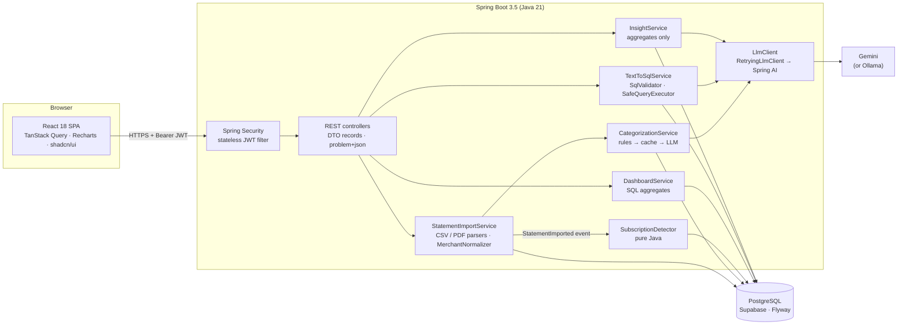
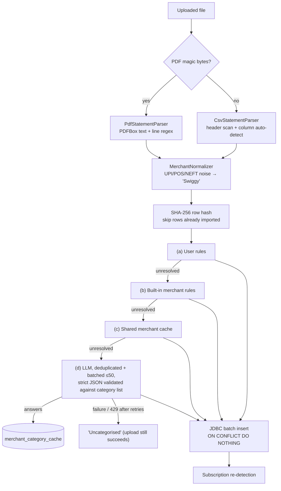
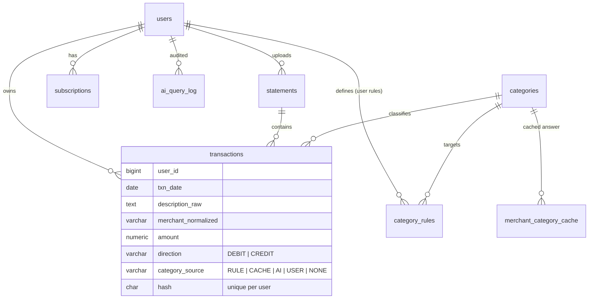

# Architecture

## System overview



## Upload → categorisation pipeline



## Ask-AI request path

```mermaid
sequenceDiagram
    participant U as User
    participant API as AskController
    participant T as TextToSqlService
    participant G as Gemini
    participant V as SqlValidator
    participant X as SafeQueryExecutor
    participant PG as Postgres

    U->>API: POST /api/ask {question}
    API->>T: ask(userId from JWT, question)
    T->>G: schema of my_transactions + today's date + question
    G-->>T: {sql, chartType, explanation}
    T->>V: validate(sql)
    Note over V: single SELECT · no comments/WITH/INTO/FOR UPDATE<br/>only my_transactions · function allowlist · LIMIT ≤ 500
    alt rejected
        V-->>T: UnsafeSqlException
        T->>G: one repair attempt with the reason
    end
    T->>X: execute(userId, validated)
    X->>PG: BEGIN READ ONLY; SET LOCAL statement_timeout='3s'
    X->>PG: WITH my_transactions AS (… WHERE user_id = ?) <validated SELECT>
    PG-->>X: rows (max 500)
    T->>PG: insert ai_query_log
    T-->>U: columns, rows, chartType, explanation, sql
```

## Data model


